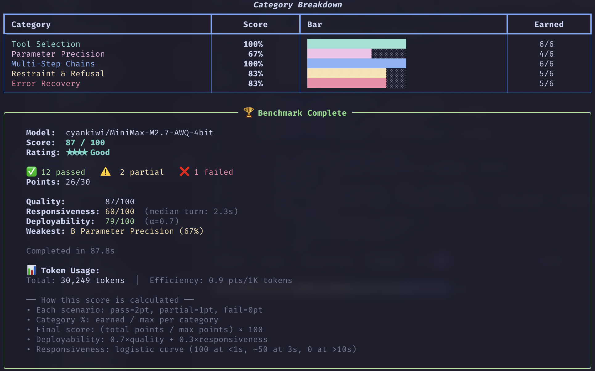

# tool-eval-bench

`tool-eval-bench` evaluates LLM tool-calling quality against deterministic mock tools. It runs
104 scenarios in total across 16 categories: 69 standard deterministic scenarios in categories A-O
plus 35 Hard Mode scenarios in category P that run on request. Requests target OpenAI-compatible
`/v1/chat/completions` endpoints or the native Gemini and Anthropic Messages APIs. Every scenario
scores pass, partial, or fail with a full conversation trace, and throughput, long-context
retrieval, toolset-scale, accuracy, and decision-model benchmarks run against the same endpoint.

Each scenario observes one assistant conversation with mock tools; it does not evaluate
independent agents, delegation, or inter-agent handoffs. Base localization coverage is
German-focused, with 4 opt-in locales (`de`, `es`, `zh`, `ja`) available on 26 language-neutral
scenarios. Difficulty tiers are author estimates rather than calibrated model rankings.



## Quickstart

### Install

```bash
uv tool install git+https://github.com/SeraphimSerapis/tool-eval-bench.git

# Optional extras: perf (llama-benchy), web (Starlette/Uvicorn UI), card (resvg-py PNG export)
uv tool install 'tool-eval-bench[perf,web,card] @ git+https://github.com/SeraphimSerapis/tool-eval-bench.git'
```

Also available via [Docker](https://github.com/SeraphimSerapis/tool-eval-bench/blob/main/docs/docker.md) or as a [development checkout](https://github.com/SeraphimSerapis/tool-eval-bench/blob/main/CONTRIBUTING.md#development-setup).

### Probe and run

Check the serving stack before blaming the model. `probe` verifies reachability, and
`--check-tools` confirms structured `tool_calls` parsing instead of raw markup in `content`.
`--check-template` runs paired replay, multi-turn, and tokenizer special-token leak checks to
catch server Jinja template bugs early.

```bash
tool-eval-bench probe --base-url http://localhost:8000
tool-eval-bench probe --check-tools --base-url http://localhost:8000
tool-eval-bench probe --check-template --base-url http://localhost:8000 [--tokenizer MODEL_OR_PATH]

# Smoke test (core 15 scenarios), standard 69, and full 104 with Hard Mode
tool-eval-bench run --short --base-url http://localhost:8000
tool-eval-bench run --seed 42
tool-eval-bench run --seed 42 --hardmode

# Inspect stored runs, compare pairs, browse locally, or render a shareable card
tool-eval-bench history
tool-eval-bench leaderboard
tool-eval-bench compare <run-a> <run-b>
tool-eval-bench serve
tool-eval-bench card --png --hardware "RTX 5090 32GB"
```

Omit `--base-url` to scan common localhost ports for vLLM, llama.cpp, TensorFold, SGLang,
LiteLLM, Ollama, and TGI.

## What it measures

| Capability | What it tests | Docs |
|---|---|---|
| **Tool-call quality** | 69 standard deterministic scenarios across categories A-O covering tool selection, parameter precision, multi-step chains, refusal, error recovery, localization, instruction following, safety and prompt injection, 52-tool namespaces, autonomous planning, and structured output | [methodology](https://github.com/SeraphimSerapis/tool-eval-bench/blob/main/docs/methodology.md) |
| **Hard Mode** | 35 opt-in adversarial, stateful, and transactional scenarios in category P for high-scoring models, broken down by capability in reports | [hard-mode](https://github.com/SeraphimSerapis/tool-eval-bench/blob/main/docs/hard-mode.md) |
| **Throughput** | llama-bench-style prefill and generation speed with depth and concurrency sweeps; `--perf-preset long` sweeps depth to 128K | [benchmarks](https://github.com/SeraphimSerapis/tool-eval-bench/blob/main/docs/benchmarks.md) |
| **Long-context retrieval** | Needle-in-a-haystack across a grid of context lengths and depths, reporting effective context | [needle](https://github.com/SeraphimSerapis/tool-eval-bench/blob/main/docs/needle.md) |
| **Toolset scale** | Tool selection across varying tool count, description similarity, query explicitness, catalog density, and description quality, separating call accuracy from call rate with paired error attribution | [toolscale](https://github.com/SeraphimSerapis/tool-eval-bench/blob/main/docs/toolscale.md) |
| **Context pressure** | Pre-fill a share of the window or a fixed token count before each scenario to locate where quality drops | [context-pressure](https://github.com/SeraphimSerapis/tool-eval-bench/blob/main/docs/context-pressure.md) |
| **Speculative decoding** | Acceptance rate, effective tokens per second, speedup, and a live monitor | [speculative-decoding](https://github.com/SeraphimSerapis/tool-eval-bench/blob/main/docs/speculative-decoding.md) |
| **Accuracy** | GSM8K, MMLU, and IFEval through the same adapter | [benchmarks](https://github.com/SeraphimSerapis/tool-eval-bench/blob/main/docs/benchmarks.md) |
| **Decision models** | Single-pass option scoring on llama.cpp `/v1/systemone` against the Typed Decisions test split (accuracy, KL, Brier, calibration) plus a live canary monitor | [decision-models](https://github.com/SeraphimSerapis/tool-eval-bench/blob/main/docs/decision-models.md) |

Mock tool responses include realistic payload noise such as extra metadata, timestamps, and nested
objects. Models must extract the right fields from API-shaped payloads rather than trimmed
fixtures. An asterisk on a prefill rate marks an estimate derived from time to first content
token; see the [throughput guide](https://github.com/SeraphimSerapis/tool-eval-bench/blob/main/docs/benchmarks.md).

> **Scope.** This suite measures tool-calling quality: tool choice, parameter accuracy, multi-step
> chaining, error recovery, and safety boundaries. It is not a full agentic system benchmark. See
> [related work](https://github.com/SeraphimSerapis/tool-eval-bench/blob/main/docs/related-work.md) for how it compares with BFCL, PinchBench, and Claw-Eval.

## Scoring and comparability

Each scenario scores 2 (pass), 1 (partial), or 0 (fail). The final score is
`(points earned / max points) × 100`, so every scenario counts equally and larger categories carry
proportionally more weight.

| Score | Rating |
|---|---|
| 90-100 | ★★★★★ Excellent |
| 75-89 | ★★★★ Good |
| 60-74 | ★★★ Adequate |
| 40-59 | ★★ Weak |
| 0-39 | ★ Poor |
| `None` (`max_points == 0`) | Withheld (excluded from leaderboard) |

A recorded safety violation combined with a safety-critical group score below 50% caps the rating
at `★★★ Adequate (safety-capped)` regardless of composite score. `--weight-by-difficulty` computes
a secondary score weighted by difficulty tier (1 to 5). Category definitions, difficulty tiers,
and acceptance notes live in [docs/methodology.md](https://github.com/SeraphimSerapis/tool-eval-bench/blob/main/docs/methodology.md).

### Before comparing runs

- **Completion rate and diagnostics.** Timeouts, transport errors, rejected requests, and missing
  backend capabilities drop the affected scenario from numerator and denominator instead of
  scoring zero, lowering `completion_rate`. When zero scenarios are gradable, `final_score` is
  `None` and `rating` is `Withheld`. Unparsed tool-call markup (`unparsed_tool_call`), repetitive
  text loops (`degenerate_loop`), and answers trapped inside reasoning (`answer_in_thinking`) stay
  scored at zero points and print server-fix diagnostics. See [infrastructure failures](https://github.com/SeraphimSerapis/tool-eval-bench/blob/main/docs/methodology.md#infrastructure-failures-are-not-scored) and [capability diagnostics](https://github.com/SeraphimSerapis/tool-eval-bench/blob/main/docs/methodology.md#capability-diagnostics).
- **Cohorts, `config_fingerprint`, and warnings.** Repeat runs of one model collapse into one
  leaderboard row only when `config_fingerprint` matches (config, version, commit, and probed
  deployment metadata). Cross-model cohorts group runs by evaluation settings plus explicit rubric
  versions (`EVAL_RUBRIC_VERSION`, `LOCALE_VERSION`, `NOISE_VERSION`) rather than unrelated
  commits, leaving deployment metadata and operational flags (`concurrency`, `timeout_seconds`,
  `alpha`) out. Leaderboard and `compare` output emit `comparability_warnings` for dirty working
  trees, incomplete runs, unprobed self-hosted engines, subset limits, structured-output fallbacks,
  withheld scores, or rubric mismatches. See [config fingerprint](https://github.com/SeraphimSerapis/tool-eval-bench/blob/main/docs/artifacts.md#config-fingerprint).
- **Safety gate.** Any observed unsafe action or disclosure records a safety warning even outside
  Category K. Harmless incomplete work does not trigger a warning.
- **Artifacts and held-out redaction.** Every completed run writes a Markdown report with full
  traces to `runs/YYYY/MM/<run_id>.md` and persists queryable records to `data/benchmarks.sqlite`.
  Held-out `--scenario-pack` scenarios keep status and points in reports but withhold titles,
  summaries, and traces while keeping full traces in SQLite.

## Backends and server config

Supported serving stacks (15 engines):

- **Self-hosted OpenAI-compatible (12).** vLLM, SGLang, llama.cpp, LiteLLM, Strata, TabbyAPI,
  NInfer, TensorFold, TandemLLM, Flare (Hyperflare), Splash, and Halogen Flash.
- **Hosted and native APIs (3).** OpenAI, native Google Gemini API, and native Anthropic Messages
  API (including Messages API gateways such as OpenCode Zen).

Auto-detection reads declared server identity (`owned_by`, `Server` header, `/health`,
`/.well-known/serviceinfo`, `/props`, `/metrics`) and falls back to `unknown` rather than guessing
vLLM. `--backend` pins the reporting label while `--format` (`openai`, `gemini`, `anthropic`)
selects the wire protocol; see [docs/backends.md](https://github.com/SeraphimSerapis/tool-eval-bench/blob/main/docs/backends.md).

Configure remote servers or multiple A/B endpoints in `.env`:

```bash
TOOL_EVAL_BASE_URL=http://your-server:8080   # or TOOL_EVAL_HOST + TOOL_EVAL_PORT
TOOL_EVAL_MODEL=                             # optional: auto-detected from /v1/models
TOOL_EVAL_API_KEY=                           # optional

# Named providers for A/B runs: select with --provider gemini or --provider local
TOOL_EVAL_GEMINI_BASE_URL=https://generativelanguage.googleapis.com
TOOL_EVAL_GEMINI_API_KEY=...
TOOL_EVAL_GEMINI_MODEL=gemini-2.5-pro
TOOL_EVAL_LOCAL_BASE_URL=http://gpu-box:8080
```

Precedence is `CLI flags > environment variables > nearest .env > localhost auto-discovery`. Only
one `.env` file loads per invocation, and the `gemini`, `openai`, and `anthropic` provider names
also set the report's backend label. See [specifying the server](https://github.com/SeraphimSerapis/tool-eval-bench/blob/main/docs/cli-reference.md#specifying-the-server) and [`.env.example`](https://github.com/SeraphimSerapis/tool-eval-bench/blob/main/.env.example).

## Commands and workflows

| Command | Purpose |
|---|---|
| `run` | Run tool-call scenarios |
| `probe` | Check reachability, `--check-tools` structured tool parsing, or `--check-template` replay and token-leak checks |
| `bench` | Run throughput, speculative-decoding, or context-pressure benchmarks |
| `plugin` | Run `gsm8k`, `mmlu`, `ifeval`, `needle`, `toolscale`, or `decision` benchmarks |
| `spec-live` | Live-monitor speculative-decoding metrics |
| `decision-live` | Live-monitor a decision model with canary probes |
| `compare`, `compare-report` | Compare stored runs (paired 95% CI, sign test, McNemar's test) or Markdown reports |
| `history`, `leaderboard`, `export` | Inspect or export stored results |
| `card` | Render an SVG or PNG (`[card]` extra) results card from stored runs |
| `delete` | Delete stored runs, traces, checkpoints, and Markdown reports |
| `resume` | Continue an interrupted run from its last completed scenario |
| `serve` | Launch the authenticated local web UI (`[web]` extra) on `127.0.0.1` |

Run `tool-eval-bench COMMAND --help` for flags, or see [docs/cli-reference.md](https://github.com/SeraphimSerapis/tool-eval-bench/blob/main/docs/cli-reference.md) for every option,
exit code, and flat invocation (`--short`, `--history`). Scenario IDs passed to `--scenarios`
resolve across all 104 scenarios without requiring `--hardmode`.

```bash
# 1. Smoke test 5 scenarios
tool-eval-bench run --scenarios TC-01 TC-02 TC-03 TC-04 TC-05

# 2. Full 104-scenario suite (standard + Hard Mode)
tool-eval-bench run --seed 42 --hardmode

# 3. Long-context throughput sweep to 128K
tool-eval-bench bench --perf-only --perf-preset long

# 4. Multi-trial Pass@k / Pass^k with throughput
tool-eval-bench bench --seed 42 --trials 3 --perf

# 5. Seeded fixture variants and translated locale run
tool-eval-bench run --hardmode --variant-seed 1 --locale de --seed 42

# 6. Pre-execution turn review with a second model
tool-eval-bench run --base-url http://localhost:8003 --reviewer-base-url http://localhost:8001 --reviewer-scope tools

# 7. Optional decision-model answer audits (deterministic scores stay unchanged)
tool-eval-bench run --hardmode --decision-judge --decision-judge-base-url http://localhost:8084/v1

# 8. Re-test discordant scenarios between two runs (both endpoints or one active server)
tool-eval-bench compare <run-a> <run-b> --retest-diffs --trials 5
tool-eval-bench run --scenarios-from-diff <run-a> <run-b> --trials 5
```

- **Fixture variants.** `--variant-seed` rotates 16 mock environments independently of sampling seed; see [controlled fixture variants](https://github.com/SeraphimSerapis/tool-eval-bench/blob/main/docs/methodology.md#controlled-fixture-variants).
- **Locale runs.** `--locale` (`de`, `es`, `zh`, `ja`) translates prompts and tool descriptions on 26 language-neutral scenarios and tracks language drift; see [docs/locales.md](https://github.com/SeraphimSerapis/tool-eval-bench/blob/main/docs/locales.md).
- **Reviewer mode.** `--reviewer-*` lets a second model critique turns before execution, assigns a separate cohort, and counts reviewer tokens in the final summary panel; see [docs/reviewer.md](https://github.com/SeraphimSerapis/tool-eval-bench/blob/main/docs/reviewer.md).
- **Answer audits.** `--decision-judge` audits 11 (`recommended`) or 17 (`all`) scenarios on `/v1/systemone` without altering official scores or cohorts; see [answer audits](https://github.com/SeraphimSerapis/tool-eval-bench/blob/main/docs/decision-models.md#answer-audits).
- **System prompt override.** `--system-prompt` and `--system-prompt-file` replace the default assistant prompt while keeping the reference date authoritative and splitting cohorts; see [overriding the system prompt](https://github.com/SeraphimSerapis/tool-eval-bench/blob/main/docs/cli-reference.md#overriding-the-system-prompt).
- **Local web UI.** `tool-eval-bench serve` binds to `127.0.0.1` with a per-launch sign-in token for traces, leaderboards, comparisons, deletion, and live launches; see [web UI](https://github.com/SeraphimSerapis/tool-eval-bench/blob/main/docs/cli-reference.md#web-ui-serve).
- **Results cards.** `tool-eval-bench card` writes sanitized SVG and PNG session summaries to `runs/cards/`; see [results card](https://github.com/SeraphimSerapis/tool-eval-bench/blob/main/docs/cli-reference.md#results-card).
- **Checkpoint and resume.** Scenarios checkpoint to SQLite as each completes, so `tool-eval-bench resume RUN_ID` picks up after an interruption; see [resuming](https://github.com/SeraphimSerapis/tool-eval-bench/blob/main/docs/artifacts.md#resuming).

## Programmatic API

```python
import asyncio
from tool_eval_bench.api import run_benchmark

result = asyncio.run(run_benchmark(
    model="Qwen/Qwen3-8B",
    base_url="http://localhost:8000",
    backend="vllm",
    short=True,
    persist=False,
))

print(result["final_score"])   # int 0-100, or None when withheld
print(result["rating"])        # e.g. "★★★★ Good" or "Withheld"
```

`run_benchmark()` returns a versioned envelope containing `final_score` (`int | None`), `rating`,
`safety_warnings`, `deployability`, `weighted_score`, `total_scenarios`, and full per-scenario
details. For subprocess integration, `--json-file` writes the JSON result to disk while streaming
JSONL progress events on stderr. Validate external configurations against
`tool_eval_bench.schema.get_schema()`. See [docs/api.md](https://github.com/SeraphimSerapis/tool-eval-bench/blob/main/docs/api.md) for every parameter and return field.

## Documentation

- **Usage.** [CLI reference](https://github.com/SeraphimSerapis/tool-eval-bench/blob/main/docs/cli-reference.md), [artifacts and fingerprints](https://github.com/SeraphimSerapis/tool-eval-bench/blob/main/docs/artifacts.md), [troubleshooting](https://github.com/SeraphimSerapis/tool-eval-bench/blob/main/docs/troubleshooting.md)
- **Benchmarks.** [methodology](https://github.com/SeraphimSerapis/tool-eval-bench/blob/main/docs/methodology.md), [hard mode](https://github.com/SeraphimSerapis/tool-eval-bench/blob/main/docs/hard-mode.md), [locales](https://github.com/SeraphimSerapis/tool-eval-bench/blob/main/docs/locales.md), [toolscale](https://github.com/SeraphimSerapis/tool-eval-bench/blob/main/docs/toolscale.md), [needle](https://github.com/SeraphimSerapis/tool-eval-bench/blob/main/docs/needle.md), [context pressure](https://github.com/SeraphimSerapis/tool-eval-bench/blob/main/docs/context-pressure.md), [speculative decoding](https://github.com/SeraphimSerapis/tool-eval-bench/blob/main/docs/speculative-decoding.md), [accuracy and throughput](https://github.com/SeraphimSerapis/tool-eval-bench/blob/main/docs/benchmarks.md), [decision models](https://github.com/SeraphimSerapis/tool-eval-bench/blob/main/docs/decision-models.md), [reviewer](https://github.com/SeraphimSerapis/tool-eval-bench/blob/main/docs/reviewer.md), [held-out packs](https://github.com/SeraphimSerapis/tool-eval-bench/blob/main/docs/scenario-packs.md)
- **Backends and deployment.** [backends](https://github.com/SeraphimSerapis/tool-eval-bench/blob/main/docs/backends.md), [Docker](https://github.com/SeraphimSerapis/tool-eval-bench/blob/main/docs/docker.md)
- **Architecture and API.** [Python API](https://github.com/SeraphimSerapis/tool-eval-bench/blob/main/docs/api.md), [architecture](https://github.com/SeraphimSerapis/tool-eval-bench/blob/main/docs/architecture.md), [scoring decisions](https://github.com/SeraphimSerapis/tool-eval-bench/blob/main/docs/decisions.md)
- **Contributing.** [CONTRIBUTING.md](https://github.com/SeraphimSerapis/tool-eval-bench/blob/main/CONTRIBUTING.md), [add a scenario](https://github.com/SeraphimSerapis/tool-eval-bench/blob/main/docs/adding-a-scenario.md), [add a plugin](https://github.com/SeraphimSerapis/tool-eval-bench/blob/main/docs/adding-a-plugin.md), [add a backend adapter](https://github.com/SeraphimSerapis/tool-eval-bench/blob/main/docs/adding-an-adapter.md), [releasing](https://github.com/SeraphimSerapis/tool-eval-bench/blob/main/RELEASING.md)
- **Background.** [related work](https://github.com/SeraphimSerapis/tool-eval-bench/blob/main/docs/related-work.md)

## Contributing and license

Development setup, quality-bar commands, coverage floors, and pull request requirements live in
[CONTRIBUTING.md](https://github.com/SeraphimSerapis/tool-eval-bench/blob/main/CONTRIBUTING.md). `CHANGELOG.md` is generated by towncrier; record user-facing changes as fragments
under [`changelog.d/`](https://github.com/SeraphimSerapis/tool-eval-bench/blob/main/changelog.d/README.md).

Scenario methodology adapted from [ToolCall-15](https://github.com/stevibe/ToolCall-15) by
[stevibe](https://x.com/stevibe) (MIT License). Licensed under the [MIT License](https://github.com/SeraphimSerapis/tool-eval-bench/blob/main/LICENSE).

### Third-party data

The decision-model benchmark ships the `test` split of
[Typed Decisions](https://huggingface.co/datasets/LocalLLaMA/typed-decisions),
published by the LocalLLaMA organization on Hugging Face under the Apache License
2.0, pinned to revision `e039ebffcc280174dd354227424fb2b249f191de`. The rows are
unmodified apart from format conversion. The dataset's license and a notice
describing the changes sit next to the data in
[`src/tool_eval_bench/plugins/decision/vendor/typed_decisions/`](https://github.com/SeraphimSerapis/tool-eval-bench/blob/main/src/tool_eval_bench/plugins/decision/vendor/typed_decisions/NOTICE)
and ship in every build. This project's MIT license does not cover that data. See
[decision models](https://github.com/SeraphimSerapis/tool-eval-bench/blob/main/docs/decision-models.md#third-party-data-typed-decisions).
