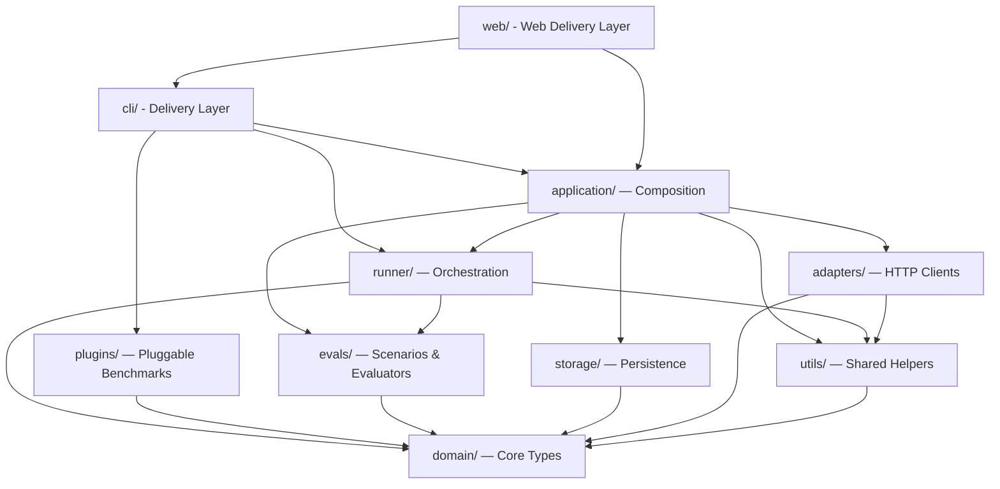

# Architecture

This document describes the internal architecture of `tool-eval-bench`.
For contributor conventions and quality bar, see [AGENTS.md](../AGENTS.md).
For adding new scenarios, see [CONTRIBUTING.md](../CONTRIBUTING.md).

---

## Layered Architecture



### Dependency Rules

| Layer | May Import | Must NOT Import |
|---|---|---|
| `domain/` | stdlib and other domain modules | storage, concrete adapters, application, runner, cli, evals |
| `evals/` | domain | storage, adapters, runner, cli |
| `runner/` | domain ports, evals, utils | storage, concrete adapters, application, cli |
| `plugins/` | domain ports | storage, concrete adapters, application, cli, runner, evals |
| `storage/` | domain | adapters, runner, cli, evals |
| `application/` | domain, evals, runner, adapters, storage, utils | cli |
| `adapters/` | domain ports, utils | storage, application, runner, cli, evals |
| `cli/` | everything else (delivery layer) | `storage.db` |
| `web/` | everything else (delivery layer) | `storage.db` |
| `utils/` | stdlib, domain | storage, adapters, runner, cli, evals |

`cli/` and `web/` may format reports through `storage.reports`, which is a renderer, but must not open the
database. Connection lifetime, query shape, and the write-then-persist ordering belong to
`application/`; `application/run_queries.py` holds the reads the delivery layer needs, and
`application/run_deletion.py` the one delete path.

These rules describe first-party layer imports. Measurement runners such as
throughput, speculative decoding, and context pressure use the
`domain.measurement.MeasurementClient` port. Its HTTP adapter preserves raw
SSE lines so runners retain exact arrival timing without importing the concrete
HTTP client. Scenario orchestration continues to use the `BackendAdapter` port.
`spec_live.py` remains separate because it is a long-lived Prometheus monitor,
not a bounded benchmark measurement request.

---

## Module Reference

### Package Root

| Module | Purpose |
|---|---|
| `api.py` | The public programmatic entry point. `run_benchmark()` is the supported integration surface; see [api.md](api.md) |
| `schema.py` | Machine-readable CLI argument schema and output schema versioning |
| `__main__.py` | `python -m tool_eval_bench` entry point |
| `__init__.py` | Version resolution and a convenience re-export of `run_benchmark` |

### `domain/` — Core Types

The domain layer defines all data structures and contracts. It has zero
external dependencies.

| Module | Purpose |
|---|---|
| `adapters.py` | Backend adapter port and provider-neutral chat result/tool-call types |
| `scenarios.py` | `ScenarioDefinition`, `ScenarioEvaluation`, `ScenarioState`, `Category` enum, `FailureKind`, scoring functions, safety gating |
| `models.py` | `BenchmarkConfig` dataclass and `ChatMessage` types |
| `measurement.py` | `MeasurementClient` port and raw streaming response types |
| `spec_decode.py` | Per-position acceptance arithmetic shared by the spec runner and its report renderer |
| `engines.py` | One `EngineProfile` per inference engine: backend labels, display names, metrics namespaces and identity precedence, declared identity names, spec-counter rules, and whether the recorded context window is per-request. Probing mechanics stay in `utils/metadata.py` |
| `plugin.py` | `BenchmarkPlugin` ABC, `BenchmarkResult` dataclass, and inline `<think>` extraction helpers for pluggable benchmarks |
| `decision.py` | Domain types, answer-audit judge set constants, and port for `/v1/systemone` decision models |
| `filler.py` | Filler prose corpus shared by context pressure and needle retrieval |
| `loop_detection.py` | Deterministic detection of degenerate n-gram and character-run repetition loops in output and reasoning |
| `rubric.py` | Single source of truth for `EVAL_RUBRIC_VERSION`, `LOCALE_VERSION`, `NOISE_VERSION`, and the `RUBRIC_AST_FINGERPRINT` AST gate |
| `wire_hygiene.py` | Detection of unparsed tool-call markup (including Gemma 4 markers), special-token leaks, and server parser flag advice |
| `review.py` | `ReviewerSettings`, the review scopes, and `review_applies`: which turns a reviewer checks and which fields inherit from the run |
| `tools.py` | Universal tool definitions (12 tools), system prompt |
| `tools_large.py` | Extended 52-tool definitions for Category L |
| `errors.py` | Structured error code constants |
| `redaction.py` | `redact_url` and `redact_urls`, so storage can redact server URLs without importing `utils` |
| `card.py` | `CardData` and its parts, the contract between `application/card_data.py` and the card renderer. It has no field for a session id, run id, hostname, or server URL, so none can reach a shared image |

### `evals/` — Scenarios & Evaluators

Each scenario is one file under `evals/scenarios/<group>/tcNN.py`, holding a
self-contained `ScenarioDefinition`:
- A **user message** (the prompt)
- A **mock handler** (deterministic tool responses)
- An **evaluator** (scoring logic: pass/partial/fail)
- A `DISPLAY` entry describing its success and failure cases

A group package discovers its own `tcNN.py` files, so creating the file is the
whole registration. Helpers used by more than one scenario in a group live in
that group's `_shared.py`; they stay group-scoped because several groups define
different helpers under the same name.

| Group | Categories | Scenarios |
|---|---|---|
| `scenarios/core/` | A–E (the original 15) | TC-01 – TC-15 |
| `scenarios/extended/` | F–G | TC-16 – TC-21 |
| `scenarios/agentic/` | H–K (partial) | TC-22 – TC-36, TC-41 – TC-50 |
| `scenarios/adversarial/` | K (safety extras) | TC-57 – TC-60 |
| `scenarios/large_toolset/` | L | TC-37 – TC-40 |
| `scenarios/planning/` | M–N | TC-51 – TC-56, TC-61 – TC-63 |
| `scenarios/structured/` | O | TC-64 – TC-69 |
| `scenarios/hardmode/` | P (opt-in) | TC-70 – TC-74 |
| `scenarios/hardmode_expanded/` | P (opt-in expansion) | TC-75 – TC-84 |
| `scenarios/hardmode_transactional/` | P (transactional and reasoning continuity) | TC-85 – TC-89, TC-99, TC-100, TC-103 |
| `scenarios/hardmode_governance/` | P (policy, authorization, and tenancy) | TC-90 – TC-92, TC-98, TC-101, TC-104 |
| `scenarios/hardmode_documents/` | P (document pages, formats, and layers) | TC-93 – TC-97, TC-102 |
| `packs.py` | none | Held-out YAML scenario-pack loading and content attestations |
| `yaml_loader.py` | none | The declarative scenario format, used by held-out packs |
| `yaml_scenarios/` | none | Three worked YAML examples: a single call, a chain, and restraint |
| `helpers/` | none | Shared evaluator utilities package (`__init__.py` facade over `_text.py`, `_intent.py`, `_state.py`, `_dates.py`, `_mocks.py`) |
| `locales/` | none | Opt-in multilingual translation packs (`de.json`, `es.json`, `ja.json`, `zh.json`), anchor enforcement, answer normalization, and language-drift diagnostics (`__init__.py`) |
| `milestones.py` | none | Milestone and minefield grading for stateful scenarios |
| `variants.py` | none | Seeded deterministic fixture variants (`--variant-seed`) that preserve public scenario IDs |
| `noise.py` | none | Deterministic payload enrichment for realistic API noise |

Registries, all built by `evals/scenarios/__init__.py`:
- `SCENARIOS` — core 15 (used by `--short`)
- `ALL_SCENARIOS` — full 69
- `ALL_SCENARIOS_WITH_HARDMODE` — full 104

The CLI's public scenario selection follows these rules:

- The default pool is the standard 69 scenarios.
- `--hardmode` adds all 35 Category P scenarios. `--hardmode-only` selects
  Category P alone.
- Explicit IDs resolve against all 104 public scenarios, so
  `--scenarios TC-85` selects a Hard Mode scenario without `--hardmode`.
  Explicit IDs take precedence over `--short` and `--categories`.
  Unknown IDs fail before model discovery.
- To select Category P by category, use `--hardmode --categories P` or
  `--hardmode-only`.
- `--scenario-pack` appends held-out scenarios, while `--pack-only` makes the
  pack the only pool. Pack IDs cannot collide with public IDs.

#### Declarative YAML scenarios

A scenario can also be authored as a YAML data file, loaded by
`evals/yaml_loader.py`. `evals/yaml_scenarios/` holds three worked examples: a
single call, a two-call chain, and restraint.

This exists for [held-out packs](scenario-packs.md), where a third party needs
private scenarios without shipping executable Python. It is not a migration
path for the 104 public scenarios: the subset matches tool calls positionally
and cannot inspect tool results, while 77% of the Python evaluators read the
model's free text and 33% read what a tool returned. `answer_contains` reaches
the PARTIAL tier, which is the one gap worth closing; the rest of the
difference is what makes Python the right language for an evaluator.

### `runner/` — Orchestration

| Module | Purpose |
|---|---|
| `orchestrator/` | Multi-turn scenario orchestration package: `__init__.py` facade, `loop.py` (core scenario loop and concurrent batch runner), `probes.py` (diagnostic tool-call and `tool_choice="required"` wire probes), `review_hook.py` (turn-review integration and revision validation), `scoring.py` (pure score aggregation, withheld scores, loop/thinking counts), and `wire.py` (argument parsing, error injection, failure classification, trace formatting) |
| `review.py` | `TurnReviewer`: the reviewer prompt, the transcript it reads (without context-pressure filler), verdict parsing, the revision request, and per-scenario `ReviewStats`. Review errors never fail a scenario |
| `template_probe.py` | Chat-template replay fidelity (`tool_replay`, `multi_turn`, plus single-turn twins) and special-token leak probe (`probe --check-template`) |
| `service.py` | Compatibility re-export of the application-owned `BenchmarkService` |
| `throughput.py` | Built-in streaming pp/tg measurement |
| `spec_detection.py` | Spec-decode detection, Prometheus counters, and metric scraping; no dependency on benchmark runners |
| `speculative.py` | Spec-decode / MTP benchmarking (acceptance rate, effective t/s); compatibility exports for detection helpers |
| `spec_live.py` | Live monitor data layer (single-pass Prometheus scraping, delta computation) |
| `llama_benchy.py` | External llama-benchy subprocess integration |
| `context_pressure.py` | Filler generation, calibration, prefix-cache busting |
| `perf_presets.py` | `--perf-preset` grids and `plan_perf`, which turns a preset plus explicit overrides into one or two llama-benchy passes capped at the context window |

`throughput` and `speculative` both use `spec_detection`; only `speculative`
depends on `throughput` for streaming and prompt construction. Keeping detection
independent prevents a cyclic import between the two benchmark runners.

### `adapters/` — HTTP Clients

| Module | Purpose |
|---|---|
| `base.py` | Compatibility re-export of the domain-owned `BackendAdapter` port and result types |
| `measurement.py` | HTTP implementation of the domain-owned measurement port, including raw SSE arrival timing |
| `openai_compat.py` | `OpenAICompatibleAdapter` for `/v1/chat/completions` endpoints (vLLM, LiteLLM, llama.cpp, SGLang, Strata, TabbyAPI, NInfer, TandemLLM, TensorFold, Flare, Halogen Flash, Splash, hosted OpenAI, and Google's OpenAI compatibility layer) |
| `gemini.py` | `GeminiAdapter` for the native Gemini `:generateContent` API |
| `anthropic.py` | `AnthropicAdapter` for the Anthropic Messages API (`/v1/messages`), also spoken by gateways such as OpenCode Zen |
| `systemone.py` | `SystemOneAdapter` for decision models served on llama.cpp's `/v1/systemone` endpoint |
| `http_retry.py` | Shared retry, backoff, and rate-limit pacing for every adapter |
| `wire_format.py` | Which format an endpoint speaks, detected from its URL |
| `factory.py` | `build_adapter()` — picks the adapter for a base URL / `--format` |
| `requests.py` | Minimal single-shot request bodies for pre-flight and warm-up |

The `--backend` flag is a label for reports; the request format follows the
endpoint itself, detected from the base URL unless `--format` pins it.

### `plugins/` — Pluggable Benchmarks

Each plugin implements `domain.plugin.BenchmarkPlugin` and owns its own
dataset loading, evaluation, and report rendering.

| Plugin | Dataset / Source | Scope |
|---|---|---|
| `gsm8k/` | `openai/gsm8k` | 1,319 math reasoning questions (`dataset.py`, `evaluator.py`, `prompts.py`, `plugin.py`) |
| `mmlu/` | `cais/mmlu` | 14,042 multitask questions across 57 subjects (`dataset.py`, `evaluator.py`, `prompts.py`, `plugin.py`) |
| `ifeval/` | `google/IFEval` | 541 prompts across 25 programmatic constraints (`dataset.py`, `checkers.py`, `evaluator.py`, `plugin.py`) |
| `needle/` | Generated (`domain/filler.py`) | Long-context retrieval grid across depths and haystack lengths (`haystack.py`, `plugin.py`) |
| `toolscale/` | Bundled `catalog/v1.json` (272 tools) | Tool-count by description-similarity sweep requiring `tools` (`plugin.py`, `aggregate.py`, `report.py`, `catalog.py`, `grid.py`, `similarity.py`, `stats.py`) |
| `decision/` | Vendored Typed Decisions test split | Single-pass decision-model accuracy and calibration over `/v1/systemone` (`plugin.py`, `evaluator.py`, `metrics.py`, `render.py`, `live.py`, `typed_decisions.py`) |

Shared infrastructure:
- `hf_utils.py`: HuggingFace downloader (retry, resume, throttle, `datasets` library fast-path)
- `registry.py`: `get_plugin()` / `available_plugins()` lookup
- `_thinking.py`: compatibility re-exports of inline `<think>` helpers owned by `domain.plugin`

### `application/` (Composition)

| Module | Purpose |
|---|---|
| `service.py` | `BenchmarkService`, composing concrete adapters, scenario orchestration, SQLite persistence, and Markdown reporting |
| `finalization.py` | `finalize_completed_run`: writes the report before persisting, so a failed write never leaves a run marked completed without its artifact |
| `mode_runs.py` | `finalize_mode_run`, the one finalization path for context-pressure sweeps, spec-bench, throughput-only runs, and plugins. Each mode passes a `ModeRun` (what is stored) and a `ModeReport` (what is rendered); this module fingerprints the config, builds the run ID and metadata, writes the report, then persists |
| `run_config.py` | `RunSettings` and `RUN_CONFIG_FIELDS`, the one declaration of every persisted config key. Each row says whether the key is written, fingerprinted, compared on `--resume`, and kept in the leaderboard's cross-model cohort. The builder, the resume check, and the cohort exclusions all derive from it. A new run setting needs a row, and `tests/test_run_config_schema.py` fails until it has one |
| `run_context.py` | Backend detection (`identify_backend`) and `RunContext` collection, shared by the CLI and the Python API |
| `leaderboard.py` | Rubric-versioned `cohort_fingerprint` (keyed on `eval_rubric_version`, `locale_version`, `noise_version`, with legacy `tool_version` + `git_sha` fallback), `comparability_warnings`, leaderboard ranking, and McNemar's test shared by CLI and web UI |
| `comparison.py` | Paired 3-tier statistical comparison (percentage-point deltas, deterministic paired bootstrap 95% CI, exact binomial sign test, and paired `comparability_warnings`) shared by CLI and web UI |
| `decision_audit.py` | Optional `/v1/systemone` answer audits, isolated from benchmark scoring, fingerprints, and credentials |
| `resume.py` | Shared resume eligibility, checkpoint filtering, and stored-config resume planning for the CLI and web UI |
| `reviewer.py` | Reviewer validation, inheritance from the run (`resolve_reviewer`), the stored `reviewer` config block with its fingerprint view and resume check, the held-out refusal, and the startup request that `check_reviewer` sends |
| `run_queries.py` | Read queries against stored runs, each owning the repository's lifetime |
| `run_summary.py` | What the web UI shows for each run type: `headline` picks the figure a run list shows in place of a score, `detail` lays a run's measurements out as stats and a table, and `session_entry` summarizes a run for the same-session panel. Throughput, needle, and accuracy figures come from the card's readers in `card_data.py` |
| `run_deletion.py` | `delete_runs` removes runs in one transaction, then their Markdown reports, removing only a path shaped like a report the writers produce. `find_runs` selects runs by status, date, and model for the `delete` command |
| `card_data.py` | `build_card_data` maps stored runs onto `CardData`, newest completed run of each kind, copying named fields only. `load_card_data` selects the runs by session or run id through `run_queries` |

### `storage/` (Persistence)

| Module | Purpose |
|---|---|
| `db.py` | `RunRepository`: WAL-mode SQLite persistence (schema version 6, externalized `scenario_traces`, indexed `(session_id)`, `(run_type, status, created_at DESC)`, `(created_at DESC)`, and partial `(report_path)` lookups) |
| `reports/` | `MarkdownReporter`: generates `runs/YYYY/MM/<run_id>.md` reports. A facade over one writer per report type (`scenario`, `summary`, `spec_decode`, `pressure`, `throughput`), with shared helpers in `_common.py`. `mode.py` holds `ModeReport` and `write_mode_report`, the header skeleton shared by the sweep, spec-bench, throughput, and plugin reports; those modes build a `ModeReport` and let it place the file |
| `reports/card/` | Shareable results card renderer: `render_card_svg(CardData)` draws the SVG and `svg_to_png` exports PNG through the optional `[card]` extra (`resvg-py`), raising `PngExportUnavailable` without it. Panel builders split across `_panels.py` (facade), `_primitives.py`, `_score_panels.py`, `_perf_panels.py`, and `_needle_panel.py`, with layout/SVG/font helpers in `_layout.py`, `_svg.py`, `_theme.py`, `_data.py`, `_format.py`, and `_fonts.py` |

### `cli/` (Delivery Layer)

| Module | Purpose |
|---|---|
| `bench.py` | Thin CLI entry point and compatibility re-export shell |
| `command_registry.py` | Discoverable subcommand metadata and translation rules (15 public subcommands) |
| `parser.py` | Subcommand discovery and translation into the legacy runtime namespace |
| `legacy_parser.py` | Permanent flat-flag parser used by legacy invocations and translated subcommands |
| `dispatch.py` | CLI dispatch router and compatibility surface coordinating mode handlers |
| `arg_validation.py` | Argument normalization and pre-flight flag validation for CLI runs |
| `session_setup.py` | Endpoint discovery, target resolution, pre-flight gating, and context-pressure setup |
| `perf_mode.py` | Throughput benchmark planning, execution, and persistence for `--perf` / `--perf-only` |
| `resume_mode.py` | Resume validation and checkpoint recovery planning for `--resume` |
| `scored_runners.py` | Scored tool-call scenario runners (live Rich, headless `--json`, plain text) and trial summary report writing |
| `scored_run.py` | `ScoredRun`, turning CLI flags into `run_benchmark` kwargs and `RunSettings` for resume checks |
| `probe.py` | `run_probe_mode` (`probe`, `--check-tools`, `--check-template`), model/server validation, pre-flight checks, and warm-up |
| `reviewer.py` | The `--reviewer*` flags: activation, environment and provider lookup, validation, and inheritance of sampling and same-server credentials into `ReviewerSettings` |
| `compare_report.py` | HTML comparison command for Markdown reports |
| `local_commands.py` | Dry-run and local command rendering |
| `delete.py` | The `delete` command: selects runs by id or filter through `application.run_deletion`, lists them, confirms, and deletes |
| `card.py` | The `card` command: loads `CardData` through `application.card_data`, renders it with `storage.reports.card`, and writes the SVG and optional PNG |
| `model_probe.py` | Model discovery and availability probing |
| `plugin_runners.py` | Shared plugin dispatch and compatibility facade over the per-plugin CLI runners |
| `plugin_lifecycle.py` | Shared plugin execution (`run_plugin_session`) and `ModeRun`/`ModeReport` finalization handed to `finalize_mode_run` |
| `plugin_accuracy.py` | CLI runners for HuggingFace-backed accuracy benchmarks (GSM8K, MMLU, IFEval) |
| `plugin_needle.py` | CLI runner for the Needle-in-a-Haystack retrieval benchmark |
| `plugin_toolscale.py` | CLI runner for the Toolscale tool-count by similarity sweep |
| `plugin_decision.py` | CLI runner for the Decision Models (`/v1/systemone`) benchmark |
| `plugin_progress.py` | Live progress layout rendered by accuracy plugins (bar, running tally, last finished item) |
| `plugin_datasets.py` | Load-or-download with a progress spinner, including resuming an interrupted download |
| `commands.py` | Scenario resolution (`resolve_scenarios`, `resolve_all_scenarios_for_ids`) |
| `resolve.py` | Compatibility exports for scenario/sweep resolution helpers |
| `run_io.py` | Trial aggregation and JSON/progress output helpers |
| `headless.py` | The `--json` output contract: quiet console, `run_failed`, `invalid_arguments`, and `run_saved` events, and JSON-lines logging |
| `helpers.py` | Small CLI helpers: dotenv loading, URL redaction, JSON output, sweep/int parsing, plugin-run persistence, headless errors |
| `server.py` | Server discovery (with `/v1/models` to `/models` 404 fallback) and backend detection from response headers |
| `perf.py` | Throughput runners: `run_throughput` (built-in), `run_llama_benchy` (external) |
| `spec_bench.py` | Speculative-decoding / MTP benchmark runner |
| `pressure.py` | Context-pressure sweep runner |
| `display.py` | Zero-flicker streaming Rich display for scenario progress |
| `history.py` | `--history`, `--compare`, `--diff` rendering (including paired comparability warnings) |
| `leaderboard.py` | `--leaderboard`, `--export` rendering |
| `spec_live_display.py` | Rich Live terminal dashboard loop for `--spec-live` |
| `spec_live_dashboard.py` | Pure Rich layout builders for the `--spec-live` dashboard panels |
| `spec_live_rendering.py` | Shared rendering helpers for the speculative decoding dashboard |
| `decision_live_display.py` | Live Rich terminal dashboard for `--decision-live` |
| `held_out.py` | Redacts held-out scenario titles, summaries, and traces from machine-readable output |
| `modes.py` | Determines which benchmark modes execute from parsed flags and whether scenarios run |
| `provider_env.py` | Provider-scoped endpoint configuration resolved from `.env` and environment variables |
| `retest_diffs.py` | Multi-trial targeted re-testing of discordant scenarios between two stored runs |
| `timeout_advice.py` | Diagnostic explanations and suggested remediations when infrastructure timeouts occur |

### `web/` (Web Delivery Layer)

| Module | Purpose |
|---|---|
| `__init__.py` | `run_web_server()` startup entry point, socket binding, loopback/host warning, and startup banner |
| `app.py` | Starlette ASGI app, API endpoints for runs, leaderboard, comparison, export, and static asset serving |
| `launcher.py` | Endpoint probing, preset/scenario resolution, and background run/resume lifecycle management |
| `live.py` | In-memory live run SSE hub and cross-process SQLite checkpoint tailing |
| `sanitize.py` | Held-out scenario redaction, URL masking, and summary enrichment for web responses |
| `security.py` | Bearer token and `HttpOnly` cookie session gate, Host/Origin checks, and CSP headers |
| `static/` | Native ES module frontend (`app.js` router/boot, `dom.js` safe DOM builders and icons, `state.js` shared state and API client, `components.js` shared widgets, `history.js` runs rail and inspector, `leaderboard.js` cohort leaderboard, `compare.js` head-to-head comparison and comparability warnings, `live.js` launcher form and SSE observer, plus `index.html` and `styles.css`) |

### `compare_reports/` (Report comparisons)

| Module | Purpose |
|---|---|
| `summary.py` | Compare summary-style reports |
| `tool_eval.py` | Compare tool-evaluation reports and scenario traces |
| `_common.py` | Formatting helpers both comparison reports share (rounding, escaping, signed deltas, percentage classes) |

### `utils/` (Shared Helpers)

| Module | Purpose |
|---|---|
| `ids.py` | Unique run IDs and deterministic configuration fingerprints |
| `fingerprint.py` | `comparison_fingerprint`, the payload (config, deployment facts, tool version, git SHA) every run type fingerprints, and `with_config_fingerprint`, which redacts the endpoint in a mode-run config and adds that fingerprint |
| `headers.py` | Extra request headers attached to requests and CLI/env header parsing |
| `metadata.py` | System/backend metadata collection (engine probing and rubric provenance) |
| `openai_compat.py` | OpenAI-compatible request and response helpers |
| `system_prompt.py` | Validation and normalization for user-supplied `--system-prompt` / `--system-prompt-file` overrides |
| `tokenizers.py` | Offline local HuggingFace tokenizer discovery for `--perf` throughput prompts and `probe --check-template` special-token leak detection |
| `urls.py` | URL construction and header helpers; re-exports the domain redaction functions |

---

## Data Flow

### Tool-Call Benchmark

```
CLI
  │
  ├─ parse args → BenchmarkConfig
  ├─ create application.BenchmarkService(repo, reporter)
  │
  └─ service.run_benchmark()
       │
       ├─ build the adapter selected by the endpoint wire format
       ├─ for each scenario in resolved list:
       │    │
       │    ├─ orchestrator.run_scenario(scenario, adapter, config)
       │    │    │
       │    │    ├─ build messages: system + context + user + [pressure filler]
       │    │    ├─ loop (up to configured max_turns, with scenario overrides):
       │    │    │    ├─ adapter.chat_completion(messages, tools)
       │    │    │    ├─ [reviewer] review the turn; on feedback the model revises it
       │    │    │    ├─ if tool_calls: execute via scenario.handle_tool_call()
       │    │    │    ├─ noise.enrich_payload(result)
       │    │    │    └─ append tool results to messages
       │    │    │
       │    │    └─ scenario.evaluate(state) → ScenarioEvaluation
       │    │
       │    └─ yield ScenarioResult
       │
       ├─ compute scores (scenario-count-weighted)
       ├─ apply safety gate (safety-critical scenarios < 50% → cap rating)
       │
       ├─ pass scenario metadata to reporter through domain types
       ├─ reporter.write(run)      # Markdown must succeed first
       └─ repo.save(run)           # then store completed SQLite row
```

### Plugin Benchmark (GSM8K/MMLU/IFEval)

```
CLI
  │
  ├─ registry.get_plugin("gsm8k")
  ├─ plugin.run(adapter, config)
  │    │
  │    ├─ dataset.load()           # HF datasets lib or REST API
  │    ├─ for each question:
  │    │    ├─ build few-shot prompt
  │    │    ├─ adapter.chat_completion(messages)
  │    │    ├─ evaluator.extract_answer(response)
  │    │    └─ evaluator.check(extracted, expected)
  │    │
  │    └─ BenchmarkResult(accuracy, breakdown, ...)
  │
  └─ render report (terminal + Markdown)
```

---

## Extension Points

### Adding a scenario
One file under `evals/scenarios/<group>/tcNN.py`, exporting `SCENARIO` and `DISPLAY`. The group
package discovers it. Worked example: [adding-a-scenario.md](adding-a-scenario.md).

### Adding a plugin benchmark
Implement `BenchmarkPlugin` under `plugins/<name>/`, register it in `plugins/registry.py`, then
wire the CLI in `cli/legacy_parser.py`, `schema.py`, `cli/command_registry.py`, and
`cli/plugin_runners.py`, and regenerate the compatibility snapshots. Miss the CLI wiring and the
plugin runs from Python but not from `tool-eval-bench plugin <name>`. Full steps:
[adding-a-plugin.md](adding-a-plugin.md).

### Adding a backend
An OpenAI-compatible endpoint needs no code: point `--base-url` at it. Add a port to auto-discovery
in `cli/server.py` and an `EngineProfile` entry in `domain/engines.py` (`ENGINE_PROFILES`) to have
it detected by name. A native wire format needs an adapter, registered through
`adapters/wire_format.py` and `adapters/factory.py`: [adding-an-adapter.md](adding-an-adapter.md).

---

## Test Architecture

| Layer | Test Files | Count |
|---|---|---|
| Evaluator contract | `test_evaluator_contract.py` | Golden-trace PASS/FAIL/PARTIAL for TC-01–TC-15 |
| Evaluator coverage | `test_evaluators_extended.py`, `test_hardmode.py`, `test_hardmode_expanded.py`, `test_hardmode_transactional.py`, `test_structured_output.py`, `test_planning_scenarios.py` | Extended scenarios F through P |
| Evaluator robustness | `test_evaluator_robustness.py` | Crash resistance, edge cases |
| Plugin evaluators | `test_gsm8k_evaluator.py`, `test_mmlu_evaluator.py`, `test_ifeval_checkers.py` | Answer extraction, constraint checking |
| Runner | `test_orchestrator.py`, `test_throughput.py`, `test_speculative.py`, `test_spec_live.py` | Orchestration, measurement |
| Storage | `test_reporter.py`, `test_history.py`, `test_storage_metadata.py` | Persistence, reports |
| CLI | `test_display.py`, `test_leaderboard_display.py`, `test_e2e.py` | Display rendering, E2E flows |
| API | `test_api.py`, `test_plugin_interface.py` | Programmatic API, schema drift |
| Adapter | `test_adapter.py` | SSE streaming, normalize, parse, error handling (httpx mocks) |
| Invariants | `test_architecture_boundaries.py`, `test_scenario_registry.py`, `test_rubric_cohorts.py`, `test_documented_counts.py`, `test_documentation_examples.py` | Layer imports, self-registering scenarios, rubric AST fingerprint gate and rubric-versioned cohorts, prose registry counts, and executable documentation examples |
| Resource lifetime | `test_repository_lifecycle.py`, `test_checkpoint_offload.py`, `test_plugin_dataset_offload.py`, `test_probe_session.py` | No leaked connections, and nothing blocking the event loop |

This is a map, not an index: most test files are not listed. The authoritative test count and branch-coverage result come from the current
CI run; avoid copying those fast-changing values into architecture docs.
